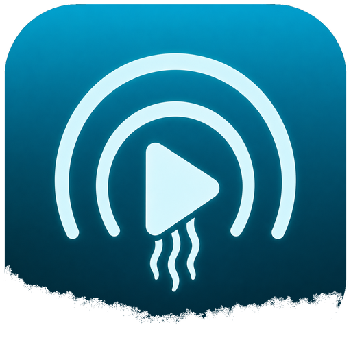

# From TraceApps

The Trace apps keep a record of your life: what you eat, lift, cook and
write down. TraceApps also makes apps with a different job. They follow the
same principles (free, no telemetry, AGPL-3.0, your data on your
hardware), but they aren't built on the Trace stack, so the shared setup
pages on this site (Docker install, Trace AI, OIDC, backups, the mobile
companion) don't apply to them. Each has its own documentation.

-   { width="120" .app-card-icon }

    **Fathom**

    Dive into your media: an all-in-one Jellyfin client for desktop and
    Android, with Seerr requests and YouTube built in.

    [:octicons-arrow-right-24: About Fathom](fathom.md)

