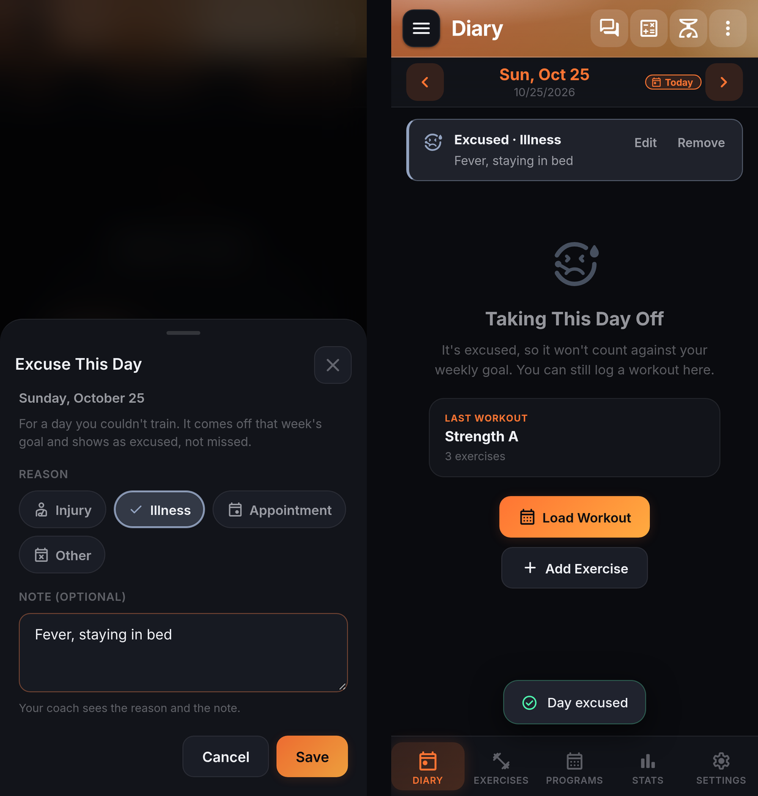

# Diary and set logging

The Diary is where every workout starts and ends. This page walks through the set-logging model, the parser and prefill helpers that save typing, and the ergonomics (rest timer, supersets, warm-ups) that separate a real lifting log from a spreadsheet.

## Anatomy of a set

Every set row carries:

- **Weight** and **reps** as separate inputs. Weight units follow your profile setting (lbs or kg).
- A **completion checkbox**. Checking it stamps the set as done, starts the rest timer if enabled, and gates superset-round completion.
- **RPE** (Rate of Perceived Exertion). Enable per-set RPE tracking in Settings > Workout. Values 1 to 10, half-steps allowed.
- **Warm-up toggle** on the row menu. Warm-ups are excluded from volume, PR detection, rest-timer firing, auto-collapse, and superset-round gating.
- **Unilateral L/R split** on exercises that ask for it (single-arm rows, split squats). Reps become two inputs.
- **Set-number override** in supersets, so a paired A1/A2/B1 flow keeps the round math right.

## Timed sets (planks, holds, carries)

Some exercises are tracked by how long you hold them, not by reps: planks, wall sits, dead hangs, hollow holds, farmer's walks. For those, the set row shows a **Time** field where reps would be. Weight stays, so a weighted plank is `25 lbs` for `1:00`; leave weight empty for bodyweight.

Typing a time works like a microwave or a phone timer: digits fill in from the right, and the field shows minutes and seconds as you type. `45` is 0:45, `130` is 1:30, `200` is 2:00. No colon needed, so it works on a phone's number pad. Seconds that overflow carry over, so `90` tidies to 1:30 when you leave the field.

Or skip typing entirely: tap the **timer** button inside the time field to start a hold. You get a three second count-in to get into position (tap the number to start straight away), then a large clock you can read from the floor. Tap **Stop** when you're done and the set is filled in and ticked off. If the set already had a time on it, from a program or your last session, you get a cue when you reach it and the clock keeps going so you can beat it. The timer uses your rest timer sound and vibration settings, keeps the screen on during the hold, and stays accurate if the phone locks.

To switch an exercise between Reps and Time, tap the chip beside its name (the same chip that sets Per Side or Alternating) and pick under **Tracked By**. Tick **Remember for this exercise** to make every future session start that way, or set it for good in the Exercise Editor. Common timed exercises such as plank, side plank, wall sit, dead hang, hollow hold, L-sit and farmer's walk start as timed without you doing anything.

Switching never deletes data. Reps you typed before switching to Time are kept and come back if you switch back. And an exercise that already has sets logged keeps the shape of that data: marking Plank as timed does not turn last month's "30 reps" planks into times.

A timed exercise's PR is its **longest hold**, or the heaviest load you held it with. Timed sets count as completed sets and as training in muscle recovery, but carry no weight x reps volume or estimated 1RM.

Sets you add on the fly through the row menu inherit the previous set's weight and reps. Empty sets never save; empty workouts auto-delete server-side.

Writes are debounced by 350 ms with optimistic UI. Pending writes flush on `pause`, `visibilitychange`, and `pagehide`, so a set entered right before backgrounding the phone hits the server or the offline queue instead of dying with the timer (fix in v1.0.1).

## Warm-ups

Warm-up sets are first-class, not free-text notes. Toggle **Auto-Generate Warm-Up Sets** in Settings > Workout and the app inserts a warm-up ramp for every working set you enter, based on the working weight and unit. Generator lives in `src/lib/workout.js` (`generateWarmupSets`).

You can also mark any set as warm-up from its row menu. Once marked, it stops counting toward volume, PRs, the completion summary, and the rest timer. Superset-round gating skips it too.

## Smart Add and the natural-language parser

The **Smart Add** button (also the sparkle FAB and the 700 ms hold on the Trace FAB) opens a text field that turns prose into structured sets. Type or paste something like:

```text
bench 3x5 @ 225
A1: curls 3x12 @ 30
A2: pushdowns 3x12 @ 40
squat 5x5 @ 315 RPE 8
pullups 3xAMRAP @ BW
overhead press 4x8 range 6-8 @ 95
```

The parser handles:

- **Cross-multiplied set specs**: `3x5 @ 225` and `5x5 @ 315`.
- **RPE targets**: `RPE 8`, `@8`.
- **Rep ranges**: `range 6-8`, `6-8 reps`.
- **AMRAP**: `AMRAP`, `x AMRAP`.
- **Timed sets**: `plank 3x45s`, `wall sit 90 seconds`, `farmer carry 3x40s @ 50`.
- **Bodyweight**: `@ BW`, `bodyweight`.
- **Supersets**: prefixes `A1:`, `A2:`, `B1:`, `B2:` group into paired exercises. Same letter = same superset.
- **Aliases**: `BB`, `DB`, `BP`, `OHP`, `DL`, `SQ`, `RDL` map to their full names.
- **Fuzzy name matching** against your exercise library: exact, then starts-with, then substring, then token overlap.

A preview screen shows what got parsed, what matched, and what did not. Fix names in place, then commit.

Voice hold-to-record uses the same parser downstream. Press and hold the Trace FAB for 700 ms, speak the workout, release. The Web Speech API or the native recognizer transcribes; the transcript feeds Smart Add and opens the review sheet.

## Progressive-overload prefill

Auto-fill Last Weights (default on; Settings > Workout) prefills weight and reps on new sets from your last completed working set for that exercise. Warm-ups are ignored for the calculation.

If the diary loaded from a program template, the template's prescription wins over last-session auto-fill. Inside a multi-week programmed block, the current week's target Sets, Reps, Tempo, Rest, and Load matrix takes precedence.

## Program template prefill

Load a workout from your active program (**Load today's workout** button on an empty day, or from the Programs page) and the diary spawns with every exercise, target rep count, target weight, warm-up marker, and RPE target from the template already in place. Add or remove sets freely; the prescription is a starting point.

## Coach prescriptions

If your coach prescribed a workout for the day, it shows on the Diary on that day with your coach's name. It asks first: **Accept** or **Decline**, and once accepted, **Load** puts it in the day. Prescriptions waiting for your answer, from any day, are listed under **Waiting for Your Answer**; accepted ones with no date sit under **Suggested by Your Coach** on an empty day. See [Coaching](coaching.md#prescriptions).

## Excused days

Some days you can't train: you're injured, you're ill, or there's an appointment you can't move. Mark those days as excused so they read differently from a day you skipped, and so they don't count against your weekly goal.



- **Excuse a day.** Open the day, then **Workout Actions** (the ⋮ button, or the Workout Actions card in the right-hand column on a wide screen) and **Excuse This Day**. An empty day also has **Couldn't Train? Excuse This Day** under its buttons. Pick **Injury**, **Illness**, **Appointment** or **Other**, add a note if you like, and **Save**.
- **Any day.** Past days, today, and days ahead, so a planned appointment or surgery can come off that week's goal before the week starts.
- **Edit or remove.** An excused day shows **Excused · Injury** (or its reason) and the note at the top of the day, with **Edit** and **Remove**. Removing one with a note asks first, since the note goes with it.
- **Your coach sees it.** If you have a coach, they see the reason and the note on your page, and a day they prescribed that you excused reaches them as excused with its reason instead of missed. The sheet says so when you have a coach.
- **Trained anyway?** A workout logged on an excused day (a completed working set, or a cardio session with Track Cardio on) counts as a workout, as on any day. The excuse stays in your history, and the day says you trained.
- **In the calendar.** The date picker marks a workout with a dot and an excused day with a ring, with a key under the month; the This Week strip in the right-hand column does the same.
- **Reminders.** No workout reminder or streak alert is sent on an excused day. The streak itself is unchanged: an excused day ends it like any day off.

Excused days sync like the rest of your diary: in the web app online and offline, in the Android app connected or used on its own (an Upload sends them, and Disconnect keeps them), and in full backups. The `GET /api/v1/excused-days` endpoint and the `get_excused_days` MCP tool read them; Trace knows about them too.

## Last-workout quick-load

Empty days show a horizontal row of quick-load cards for recent workouts. One tap prefills the whole session. Handy for "same as last Push day" without opening the programs screen.

## Rest timer

Countdown from a configurable per-set duration (Settings > Workout > Rest Duration), with per-set overrides on the set row. Auto-start on set completion is a separate toggle. Vibrate and tone are separate toggles so you can silence one without the other.

Beeps schedule via `setTimeout`, not a tick loop, so background throttling does not drop the cue. On Android the timer survives backgrounding through a native alarm (`RestTimerCuePlugin.java`) that posts a notification-channel cue at the target time.

**Pause** on the rest bar holds the rest where it is: the time stops, nothing rings, and **Resume** counts on from what was left. **+30s** works while paused too. Pausing on the phone pauses the [watch](wear.md#the-rest-timer-on-both-devices), and the other way round.

### In the notification shade and on the lock screen (Android)

While a rest runs, the Android app shows it as a notification, so you can check it without unlocking the phone:

- The title is what you lift next: **Set 3 of 4 · Bench Press**, or the next round of a superset, or the next exercise once this one is done.
- Under it, that set's weight and reps and what you did on it last time (**150 lbs × 8 · Last time 145 × 8**), from the same last session the Diary's Last row uses.
- Android counts the time down, and a bar in your accent color fills as the rest goes, like the rest bar in the app.
- **Skip Rest**, **+30s** and **Pause** work from the notification without opening the app. Paused, it says how long is left ("Rest paused, 1:12 left") and offers **Resume** and **Skip Rest**.
- Tapping it opens the Diary on that workout.

It is silent (the rest alert still makes the sound at the end, and "Rest complete" still appears), it stays on this phone rather than also showing on a paired watch, and it goes away at zero, when you skip, or when you finish the workout. Swipe it away and it stays away for that rest. On Android 16 and later, where the system allows it, it is also a Live Update: the countdown sits in the status bar as a chip.

To keep the battery cost down, the bar is redrawn about once a second only while the screen is on and the app is still running in the background; with the screen off nothing is redrawn, and the countdown itself is always drawn by Android.

If you train with Do Not Disturb on, turn on **Settings > Workout > Play Through Do Not Disturb** so you still hear the rest alert (see [Settings](settings.md#workout)).

Superset gating: in a superset the timer waits until every exercise in the round has the same completed-set count before firing. Warm-ups are excluded from the round math.

## Supersets

Visual cards group paired exercises. Sets inside the card are round-aware: A1 set 2 and A2 set 2 belong to the same round. Round-number pickers on each row let you correct the app when a set sits out or gets reshuffled.

Rest timer fires between rounds only, not between the exercises inside a round. Auto-collapse folds a completed superset the same way it folds an individual exercise.

## AMRAP, RPE, ranges, bodyweight

- **AMRAP**: set the reps field to `AMRAP` (or `A`). PR detection treats the top rep count as the score.
- **RPE**: enable per-set RPE in Settings > Workout. Trace and the completion summary annotate sets with the RPE value.
- **Rep ranges**: templates carry ranges (`6-8`). The diary shows the range as the target; the actual field takes the number you hit.
- **Bodyweight**: `@ BW` in Smart Add, or leave weight blank on any exercise marked as bodyweight in the library.

## Music during a session

When the Radio player is active, its mini-bar stays visible across every screen so you can adjust playback without leaving the diary. Full detail in [Radio player](radio.md).

## Related

- [Programs and templates](programs.md)
- [Exercise library](exercises.md)
- [Radio player](radio.md)
- [Trace in LiftTrace](trace.md)
