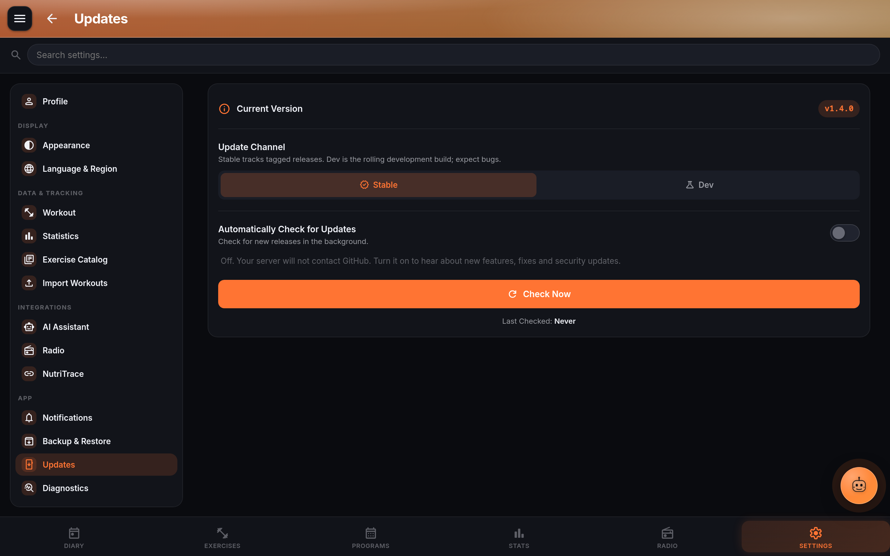
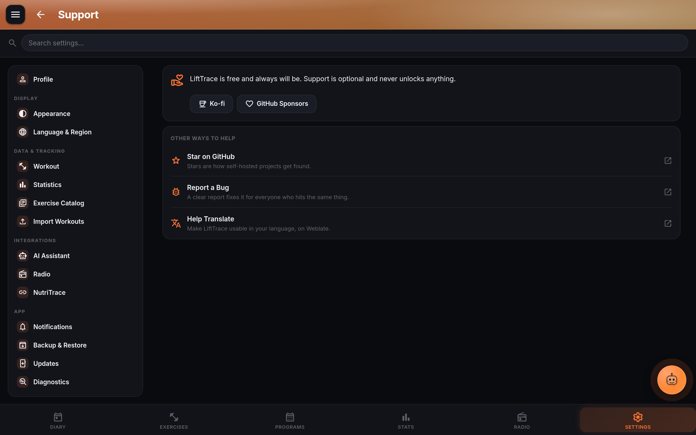

# LiftTrace settings reference

Every LiftTrace setting, grouped the way the Settings page groups them, with a one-line summary and a pointer to the page that goes deep. Per-user settings are visible to every account. Admin-only sections only show up for the `admin` role and only in server mode (they are hidden entirely on standalone Android in local mode).

Search inside Settings is powered by a keyword index at `src/routes/Settings.svelte:360`; if a setting is missing from search after an update, that index needs a same-commit entry.

## Profile

Top-of-page hero on Settings. Links out to `/profile`.

- **Full name / Nickname** display name across the app.
- **Email** used for password reset and SMTP notifications.
- **Birthday, gender, height, current weight** feed BMR estimates and the calorie-estimate overlay.
- **Avatar** upload; validated with magic-byte checks.
- **Change password / Sign out**.

## Display

### Appearance

- **Theme** Light / Dark / System.
- **Accent color** twelve presets (Iron, Mint, Blue, Red, Purple, Teal, Gold, Indigo, Pink, Rose, Cyan, Lime) plus a custom hex picker.
- **Navigation style** bottom bar, sidebar, or both.
- **Persistent sidebar** keep the sidebar pinned on desktop.
- **Start page** Diary, Exercises, Programs, Statistics, Radio, or Coaching.
- **Reduce motion** cuts animations and Trace face movement.
- **Goal celebrations** enable the streak / PR / goal-reached confetti moments.
- **Page banners** the accent-tinted headers on top of each page, with an animation-style sub-toggle (static / gradient / animated).

### Units

- **Language**: the app's language. The picker lists the languages translated so far; anything not yet translated shows in English. To add or improve a language, see [Translations](../contribute/translations.md).
- **Weight unit** lbs or kg. Body-stats, prescriptions, and charts follow.
- **Date format** US `MM/DD/YYYY`, EU `DD/MM/YYYY`, or ISO `YYYY-MM-DD`.
- **Time format** 12-hour or 24-hour.

## Data and tracking

### Workout

- **Weekly goal** target workouts per week; feeds streaks and Overview.
- **Track Cardio** (off by default) adds the Cardio card to the Diary and the Cardio view to [Statistics](statistics.md#cardio); **Weekly Cardio Minutes** under it sets that chart's target. Track Cardio is kept with your account on the server, so it follows you to your other devices, and the [MCP](mcp.md) and REST API log cardio only while it's on. An Android app from 1.4.0 or earlier keeps its own copy and never sends it: if you turned it on there, update the app or turn it on in a browser too. Until it's updated, that app takes the switch from the server each time it opens, so change it in the browser or an updated app.
- **Screen keep-awake** wake-lock during workouts (part of [Diary and set logging](diary.md)).
- **Show calorie estimate** overlays estimated kcal per session.
- **Auto-fill last weights** prefill new sets from the last completed working set.
- **Completion summary** show the 1080x1350 share card on workout finish.
- **Auto-collapse completed exercises**, **Auto-name workouts**, **Reorder method** drag handle or arrow buttons, **Confirm before removing**.
- **Auto-generate warm-up sets** insert a ramp for each working set. Generator in `src/lib/workout.js`.
- **Track RPE per set** show the RPE column on every set row.
- **Rest timer** on / off, plus **Rest duration**, **Auto-start on set**, **Vibrate**, and **Tone** as separate toggles.
- **Play Through Do Not Disturb** (Android app, off by default) plays the rest alert like an alarm, at your alarm volume, so you still hear it with Do Not Disturb on. Do Not Disturb silences notification sounds, which is how the rest alert normally plays; set up the usual way, it lets alarms through. The vibration goes the same way.

### Statistics

- **Default chart type** bar or line for muscle-group breakdowns.
- **Lock Y-axis to zero** honest comparisons across date ranges.
- **Show average line**, **Show trend line** overlays on progression charts. See [Statistics and PRs](statistics.md).

## Integrations

### Catalog

**Settings, Exercise Catalog.** Per-source enable / disable / import / clear for `wger`, `free-db`, `exercisedb` (RapidAPI key field), and `exercisedb-oss`. Per-imported-catalog enable / disable / delete. Clear and Delete say how many exercises they remove. From 1.4.0 it's also in the Android app without a server (local mode), so a library skipped or failed in the setup wizard can be imported later; switching a source off hides it on the phone too. With a server, **Offline Exercise Library** has **Pre-Cache Media for Offline**, which fetches every exercise picture in advance. Full detail in [Exercise library](exercises.md).

### AI Assistant (Trace)

- **Enable AI assistant** master switch for Trace.
- **Provider** Claude, OpenAI, Gemini, or OpenAI-Compatible.
- **Base URL** required for OpenAI Compatible (with or without `/v1`), ignored otherwise.
- **Model** dropdown of presets plus **Custom** for any model ID the vendor supports.
- **Custom model ID** free-text.
- **API key** masked; a **Change** button appears once stored.
- **Assistant name** rename Trace to whatever fits your setup.
- **Test Connection** has its own row (1.4.0 and later): run it any time, also against an OpenAI Compatible server that needs no API key. The setting you fill in last tests on its own once everything it needs is there.

Env-locked and read-only when any `AI_*` env var is set. See [Trace setup](../trace/setup.md).

### Radio

- **Self-hosted music** on / off.
- **Streaming stations** on / off.
- **Provider** Subsonic, Jellyfin, Plex, or Emby.
- **Server URL, Username / Plex token, Password / Emby API key**.
- **Crossfade** 1 to 12 seconds.
- **Highest quality playback** bit-perfect toggle, falls back to 320 kbps MP3 on mixed codecs.

Full walkthrough in [Radio player](radio.md).

### Federation

- **Enable federation**, **Instance URL** (target NutriTrace instance), **Access token**, **Wearable priority**. Posts completed workouts to NutriTrace so calorie balance updates automatically. See [NutriTrace federation](nt-federation.md).

## App

### Server connection (Android only)

Inline block near the top of Settings on the native app. Shows Connected, URL, Last Synced, **Sync Now**, **Log Out**, **Disconnect & Use Locally**. When disconnected, offers Server URL / Username / Password / **Connect to Server**, and the server's SSO buttons once you've entered its address (SSO here needs a LiftTrace 1.4.0 or later server; the password fields hide when the server allows only SSO). If the app can't load the server's sign-in options it says so, with **Retry**. Connecting with data already on the phone shows **Sync Options**: **Upload Phone to Server**, **Download Server to Phone** or **Merge Both**; changes made while connected that never reached the server are asked about before Download deletes anything. **Disconnect & Use Locally** sends changes still waiting first. See [Local vs server-connected mode](../mobile/modes.md).

### Notifications

- **Device notifications** browser or OS notification permission.
- **Push service** None, Gotify, ntfy, or Apprise; each brings provider-specific URL / token / topic / tag fields. In the Android app signed in to a server with user accounts, your server sends the pushes from these settings, so a push service on your home network works; otherwise the phone sends them itself and needs an `https://` address (from the next release; see [From the Android app](../integrations/notifications.md#from-the-android-app)).
- Per-alert toggles: **Workout reminder** (with time), **Rest-day reminder**, **Streak alert** (with time), **Workout complete**, **Personal records**, **Coach feedback**.
- **Coaching** (people in coaching only): **New Message** with **Email Me Too**, **New Recommendation**, **Client's Answer**, and for coaches **Client Completes Prescribed Workout**, **Client Missed a Prescription**, **Client Replied to Feedback**. See [Coaching](coaching.md#notifications).
- **Weekly summary** with delivery day and time.
- Android adds battery-optimization, low-battery, sound, and channel controls.

### Backup and restore

- **Full backup** create, download, restore, delete, upload-restore (server mode only, admin).
- **Auto-backup schedule** off / daily / weekly / monthly plus time and retention count (all modes). From the next release the server schedule's time is on the clock of the browser that set it, with its time zone shown; see [Scheduled backups](../self-hosting/scheduled-backups.md).
- **Clear all settings** wipes preferences (destructive).
- **Clear all data** wipes workouts and body stats (destructive).

### Import Workouts

No longer marked Experimental from 1.4.0. Picker for Strong, Hevy, FitNotes, Jefit, or Garmin FIT; upload file, preview, skip / replace on duplicate dates, commit. See [Workout history import](import.md).

### Updates

Update checks are off until you turn them on (1.4.0 and later). The setup wizard asks (**Check For Updates**), and a fresh install contacts nothing on its own until someone says yes; an install that was already running before 1.4.0 keeps checking as it did.

- **Automatically Check for Updates** turns them on or off, **Check Frequency** sets how often (Every Hour, Every 4 Hours, Every 12 Hours, Once a Day, or Manual Only), and **Check Now** checks at once (in the Android app, even with the toggle off). **Update Channel** picks Stable or Dev.
- On the web, your server asks GitHub and the browser asks your server; a banner says **A New Version Is Available** with a **Reload** button. The Android app asks GitHub itself, downloads the APK and installs it; an APK it already downloaded is reused, and the button says **Install**.
- `UPDATE_CHECK=off` on the server turns its checks off for good and locks the toggle. See [env vars](env-vars.md#update_check).

### Help and improve / Diagnostics

- **Verbose diagnostic logging** toggle.
- **View diagnostic logs** in-memory log viewer with a copy-to-clipboard button for bug reports.

## Admin

Only visible to `admin` in server mode.

### User management

- **Users list** with role picker (Admin / Trainer / Member), a trainer picker for members (choosing a trainer sends that trainer's coaching request, shown as waiting until the member answers; **No trainer** ends their coaching), **Reset user password**, **Delete user**.
- **Invite user** email (SMTP) or shareable link. For a member you can choose a **Coach**; the new account then gets that coach's request to accept or decline (the same choice is on **Add User Manually**).
- **Require strong passwords** enforces zxcvbn score >= 3.
- **Session duration** hours; capped by `MAX_SESSION_HOURS`.
- **Disable user management** danger; drops the app back to zero-user mode.
- **Enable user management** activates multi-user mode from a single-user install; creates the first admin.

### Authentication

- **OIDC providers** list (add / edit / delete / test). Per provider: Display name, Issuer URL, Client ID, Client secret (encrypted at rest with AES-GCM + HKDF), Redirect URIs, Scope, Token endpoint auth method, Admin group claim + value, Auto-link, Auto-register, Active.
- **Allow password login** server-wide toggle; env-lockable via `OIDC_ENABLE_EMAIL_PASSWORD_LOGIN`.
- Env-defined providers show up read-only with a lock badge. Full recipes: [OIDC single sign-on](../auth/oidc.md).

### Email / SMTP

- **SMTP host, port, secure, username, password, from address**.
- **Send test email** with recipient picker and a real branded HTML delivery.

Env-locked when `SMTP_HOST` is set. See [SMTP setup](../integrations/smtp.md).

## Support

Next to About (1.4.0 and later): Ko-fi and GitHub Sponsors, plus free ways to help (**Star on GitHub**, **Report a Bug**, **Help Translate**). Support is optional and never unlocks anything. See [Support](../support.md).

## About

Version, license (AGPL-3.0), and a link to the TraceApps family. `SettingsAbout.svelte` is also the entry point for checking installed version against the currently released tag.

## Related

- [Environment reference (LiftTrace)](env-vars.md)
- [Shared env vars](../self-hosting/env-vars.md)
- [Trace setup](../trace/setup.md)
- [OIDC single sign-on](../auth/oidc.md)
- [SMTP setup](../integrations/smtp.md)
