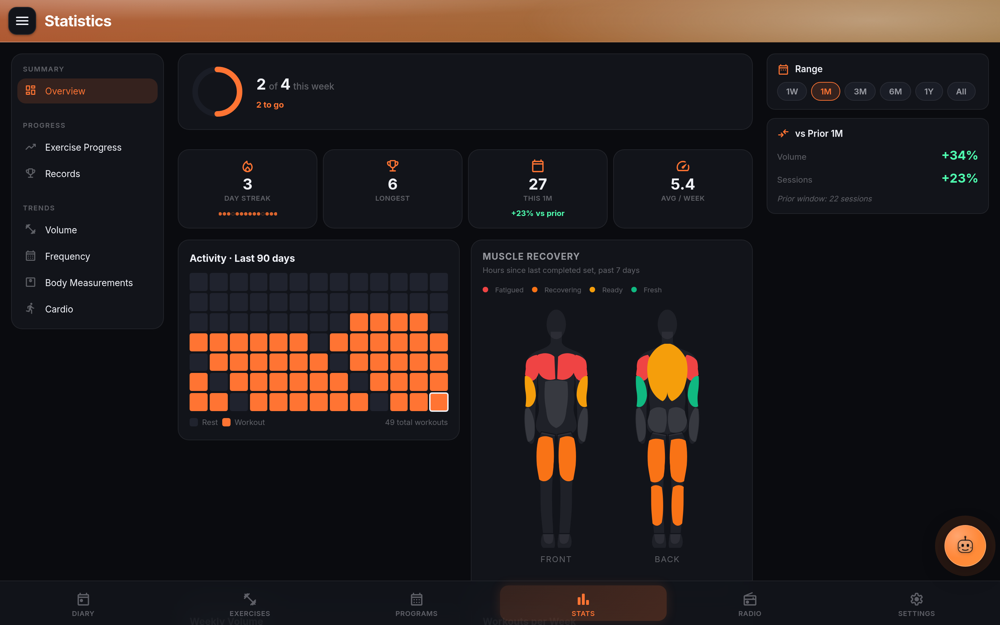
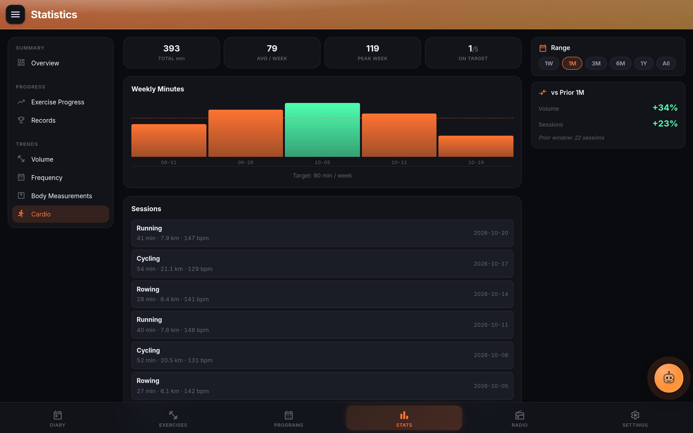
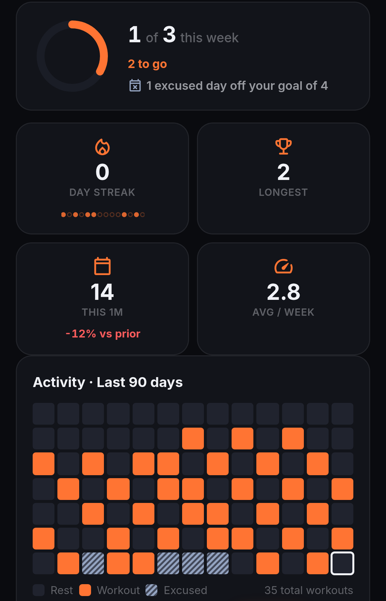

# Statistics and PRs

The Statistics tab is the training-history dashboard. Six views (Overview, Exercise Progress, Records, Volume, Frequency, Body Measurements), plus Cardio when you track cardio, a shared date range across all of them, and a metric-pill row along the top for switching. Warm-ups are excluded everywhere; only completed working sets with positive weight count.

## The metric-pill layout

Six pills at the top of the page, and a seventh, **Cardio**, with **Track Cardio** on in Settings > Workout. Tap one to switch view; the range selector below (`1W / 1M / 3M / 6M / 1Y / All`) applies globally so a range you pick on Volume carries over to Frequency and Records without a second click. Scroll position is remembered per metric, so hopping Volume > Frequency > Volume returns you to where you were.

- **Overview** the summary board: current streak, longest streak, total workouts, weekly-goal progress, muscle-recovery heatmap, and a body map colored by recent effective sets per muscle.
- **Exercise Progress** pick an exercise; get a weight-per-session sparkline plus per-session sets, volume, and average RPE. A [timed exercise](diary.md#timed-sets-planks-holds-carries) charts its longest hold per session instead.
- **Records** every exercise's current top weight and current top estimated 1RM, or its longest hold for a timed exercise.
- **Volume** weekly total volume bar chart across the range.
- **Frequency** weekly workout count plus a weekday distribution.
- **Body Measurements** logged body-weight points over time (sourced from Diary body-stats). A card at the top of this view opens [Progress photos](progress.md), the visual counterpart to the weight line.
- **Cardio** cardio minutes by week across the range, and every session in it. See [Cardio](#cardio) below.

The `All` range resolves the earliest workout in the log via `GET /api/stats/earliest-workout-date` instead of a fixed 10-year window, so imported historical data from Strong or Hevy is visible without a wall.

## Cardio

With **Track Cardio** on in Settings > Workout, the cardio sessions you log in the Diary (and with Trace or the watch) get their own **Cardio** view. Cardio is kept apart from your lifting, so it never counts toward volume, records or the lifting charts.

- **Summary**: total minutes in the range, **Avg / Week**, **Peak Week**, and with a target set, **On target**: how many weeks reached it.
- **Weekly Minutes**: a bar per week (weeks start on Monday) with that week's cardio minutes. Weeks that reach your target are highlighted.
- **Sessions**: each session in the range with its activity, minutes, distance and average heart rate when you logged them, and the date, newest first. A long range shows the 100 most recent.

The target is **Weekly Cardio Minutes** in Settings > Workout, under **Track Cardio**: the chart draws it as a line. Set it to 0 to hide the target. Turn **Track Cardio** off and the Cardio view goes away; your sessions stay.

## Charts

Chart rendering is Chart.js. Two chart types appear across the views:

- **Line / sparkline** weight or estimated-1RM progression per exercise, plus body-weight trend.
- **Bar** weekly total volume, weekly workout count, weekday distribution, weekly cardio minutes.

The default chart type for muscle-group breakdowns is user-configurable in Settings > Statistics (bar or line). Two other Settings > Statistics toggles apply globally: **Lock Y-axis to zero** for honest comparisons across ranges, and **Show trend line** for a linear regression on top of the raw points.

## Personal-record detection

A record is set the moment a completed working set beats the previous best for that exercise. Two bests are tracked per exercise:

- **Top weight** the heaviest single set logged.
- **Top estimated 1RM** using the Epley formula (`weight * (1 + reps / 30)`, or the raw weight for 1-rep sets).

For a [timed exercise](diary.md#timed-sets-planks-holds-carries) (plank, wall sit, carry) the record is the **longest hold**, with the heaviest load held as the tiebreak, and bodyweight holds count.

Warm-up sets never count. Rep sets with zero or negative weight never count. Incomplete sets (the completion checkbox never got checked) never count. Detection happens server-side on every stats query, so a PR you set in one session shows up on the Records view before you leave the page.

Inline in the Diary, a set row also gets a PR badge the moment its weight or estimated 1RM exceeds the prior best for that exercise (see [Diary and set logging](diary.md#anatomy-of-a-set)).

## Volume math

Volume for a set is `weight * reps`, adjusted by the exercise's load type: bilateral sets count as one, unilateral sets (single-arm rows, split squats) sum both sides. Warm-ups are skipped, and so are timed sets, where weight x reps has no meaning. Full logic is in [`server/lib/volume.js`](https://github.com/TraceApps/lifttrace/blob/main/server/lib/volume.js).

The weekly volume view rolls up by ISO week (Monday-anchored). The muscle-group breakdown maps each exercise to its primary muscle tag and sums; secondary muscles are ignored to keep the totals from double-counting a bench press against both chest and triceps.

## Filters and ranges

The range selector (`1W / 1M / 3M / 6M / 1Y / All`) applies to every view. The Exercise Progress view adds a picker for which exercise to plot. The muscle-group breakdown is chart-driven; tap a muscle bar to filter the underlying exercises. There is no dedicated muscle-group filter chip because the body map on Overview covers the same intent visually.

## Trained days, streaks and the weekly goal

One rule decides whether a day was trained, everywhere in LiftTrace (the Diary, Statistics, the weekly summary, reminders, your coach's view and Trace): a day counts when it has at least one completed working set (a warm-up alone doesn't count, and neither does a workout opened or cleared without anything done), or a cardio session while **Track Cardio** is on in Settings > Workout. Several workouts on one day are one day.

- **Streaks** (`GET /api/stats/streaks`): consecutive trained days, counted back from today, or from yesterday while today isn't trained yet. Today is yours, in the time zone your app last reported to the server (from the next release; the server's until then), and your coach's view of your streak counts the same. Any day without training ends it, an excused day included. Longest streak and total days trained come with it.
- **Weekly goal**: the ring at the top of the Overview counts trained days from Monday to Sunday against your goal (Settings > Workout > Weekly Goal). Each [excused day](diary.md#excused-days) in the week takes one day off the target: a goal of 4 with one injury day and three days trained reads **3 of 3**. A week with every planned day excused reads **Excused Week**, never a goal met or missed.
- **Workouts per Week** and the busiest weekdays count trained days too, and a week whose excused days bring its target within reach is marked as meeting the goal.
- **Activity · Last 90 days**: trained days in your accent color, excused days in their own striped slate, rest days plain, with a key under the grid.

Each place used to count on its own: the server's streak left cardio out, the ring counted finished workouts rather than days (two workouts on one day counted twice, and a day trained without pressing Finish didn't count), and a day with only warm-up sets counted. The weekly goal still rolls over on the current week's Monday.

## Related

- [Diary and set logging](diary.md)
- [Programs and templates](programs.md)
- [Body stats](diary.md#anatomy-of-a-set)
- [Progress photos](progress.md)
