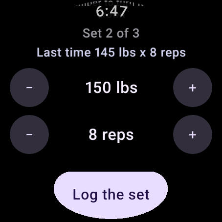

# Wear OS

LiftTrace on a watch: the session you are in, logging sets between them, the rest timer on your wrist, and finishing the workout without touching the phone. It talks to your server itself, so it keeps working with the phone in a locker.

!!! note "Wear OS 3 and up"
    Built for Wear OS 3 and newer (Android 11 on the watch). Older watches run a different app model and aren't supported.

## Setting it up

1. **Install the watch app.** The APK is on the [Releases page](https://github.com/TraceApps/lifttrace/releases) alongside the phone one. Sideload it the usual way, or install from the phone with `adb -s <watch> install`.
2. **Open LiftTrace on your phone** and sign in. That's the whole pairing: the phone sends the server address and a token to the watch over the standard Wear data connection, and the watch stores them.
3. **Open LiftTrace on the watch.** Today's session appears.

There is nothing to type on the watch, and no separate account. Signing out on the phone takes the credentials off the watch too.

!!! warning "Both apps must be signed with the same key"
    If you build the apps yourself, sign the watch app with the same key as the phone app. Wear only carries data between apps that share a package name and a signing certificate, and when they differ, pairing silently does nothing.

## Updates

Installed from the Releases page, the watch app keeps itself on the same release as the phone. When the phone app updates, it tells the watch the next time it opens, and the watch downloads that release's watch app from GitHub.

- **The first time,** opening LiftTrace on the watch shows Android's install screen, saying the watch isn't allowed to install apps from this source. Tap **Settings**, turn on **Install unknown apps** for LiftTrace, and go back: the update installs.
- **After that,** updates install by themselves while the watch is on its charger, so an update never closes the app in the middle of a workout.
- **On a watch without that setting,** each update is offered when you open LiftTrace. Cancel it and it's offered again later in the day.
- **Only forward.** The watch moves to a newer release, never back: if you put an older phone app back, the watch stays where it is until the phone passes it.
- **It needs LiftTrace 1.4.0 or later on the phone.** An older phone app doesn't tell the watch its release, so the watch stays on its own version.
- **If the app ever comes to Google Play,** a watch app installed from there will be left to Play to update.

Only the first install needs adb (step 1 above).

## What's on the watch

{ width="300" }

**The session.** Today's workout, in the order you do it, with a heading over every block: "Superset A" over a pairing you move between, "Standalone" over lifts that belong to no pairing. Each card says what it's due for next and how much is behind you, with an arrow on the one you're actually up to.

**Completed.** A block that's entirely done moves under a **Completed** heading at the bottom, keeping the order you did it in. A pairing only moves when the whole pairing is done, since half a superset is still work, and reopening a set brings it straight back up.

**Logging a set.** Tap the set you're on. The weight and reps are filled in from what the plan says or what you did last, and "Last time" shows what you lifted on this exercise before, which is the number you'd otherwise take your phone out to look up.

**The crown.** It scrolls, as it does everywhere else on a watch. Tap a number and it takes the crown: the number is outlined, and turning moves it. Tap it again to give the crown back to the list. Weight, reps, both sides of a unilateral lift and a hold can all be dialed this way.

**Rest.** It starts by itself after a set when your settings say so, and the row on the session screen counts it down in color: green while there's time, amber when it's getting on, red at the death. The watch buzzes at the end with a real alarm, so it happens with the app long gone from the screen, and says "Rest over" on the wrist rather than buzzing about nothing. `+30` gives it longer, Skip ends it.

**On the watch face.** While a rest runs it shows on the face and in the launcher's top row, counting down without the app open. The system draws the counting, so nothing wakes up to tick it. Tapping it opens the timer. Faces that don't support ongoing activities show it in the notification stream instead.

**The session clock.** How long you've been training, started, paused or stopped from either device. Stopping writes the length onto the session.

**Finishing.** Log the last set and the workout finishes by itself, as it does on the phone. To stop early, scroll to the end of the session: **Finish Workout** sits on the bottom edge once a set is done. With sets left it asks first, saying how many aren't done, and leaves them as they are. Either way the length comes off the workout timer, the timer and any rest stop on both devices, and the watch buzzes and shows how long it took, your sets and your volume, counted the way the phone's summary counts them. A finished workout has **View Summary** in the same place.

Your server then does what finishing on the phone does: the Workout Complete notification through your push service, and the workout's calories to NutriTrace when you've linked it and turned calorie estimates on. Both need the server on the same release as the watch (or later); an older server marks the workout finished but sends neither. A server without user accounts keeps no settings, so it sends nothing.

**A hold.** A timed exercise, a plank, logs itself when the time is up, whether or not the screen is still on.

**A tile.** One swipe from the watch face: the set you're on, no app launch. Add it by long-pressing the watch face, then Tiles.

**A complication.** Sets done, on the watch face itself, tapping through to the app. Add it from your watch face's own customization screen.

## Sets on both devices

A set logged, corrected or ticked on the watch shows on the phone right away while LiftTrace is open there, and the other way round, rather than at the next refresh. Neither checks while its screen is off. A save changes only the sets it changed, so a set marked done on the watch stays done when you then save something else on the phone. The same goes for finishing: a workout finished on the watch shows as finished on the phone, and stays finished when you then save a set there. The workout timer reads the same on both.

## The rest timer on both devices

A rest is one thing happening to one person, so both devices hold it and either can ring you. Start, extend, pause, resume or skip it on either and the other follows; whichever spoke last is the one that counts.

**Pause** sits beside +30 and Skip on the watch's timer. A paused rest holds its time, shows "Paused" in gray, and doesn't buzz; **Resume** counts on from what was left. Pausing on the watch pauses the phone, its rest bar and its notification, even with the app in the background, and pausing on the phone (in the app or from its notification) pauses the watch. A hold can't be paused: it logs itself when its time is up.

With a watch on an older LiftTrace, from before pausing, a paused rest is taken down on the watch instead of shown as paused, so it doesn't buzz in the middle of a pause, and it comes back counting when you resume. An older phone app takes a rest paused on the watch down when you next open it; until then, if it was in the background, it can still sound at the old time.

The phone only sends a rest to a watch whose app has been opened in the last half hour. A watch on a charger in another room isn't woken for one and doesn't buzz about it, and nothing is scheduled there. When the watch does have the rest, the phone keeps its own "Rest complete" notification to itself rather than mirroring it across, since the watch rings with its own alarm and its own words. With no watch in the picture, the phone's notification reaches your wrist the way it always did.

## Without a connection

The watch keeps the last session it loaded, so it opens and works in a gym with no signal. Anything you do while offline waits and goes up when the connection is back:

- logging, correcting, un-ticking and adding sets
- the session's length when the clock is stopped
- finishing the workout, which goes up once, with its notification and calories

The screen says "Offline" or "2 waiting" while that's true, and shows the reason in red if the server refuses. A set changed twice is one entry, not two, because the last word wins; what goes up is the whole day with your changes replayed onto whatever the phone did in the meantime, so neither device overwrites the other.

The tile and the complication read the same saved copy, so they show something sensible with no connection and no battery cost.

## Battery

Nothing polls. The rest timer is a deadline with an alarm set for it rather than something counting, so a sleeping screen costs nothing, and every repeating thing on screen stops the moment your wrist drops. Over seven hours on a wrist with normal use, the watch app's share measures in seconds of CPU.

## What it doesn't do

Building and editing programs, exercise management, statistics, body stats, coaching and the radio all stay on the phone and the web app. The watch is for the part of a workout where your hands are busy.

## Related

- [Diary & logging](diary.md)
- [Programs](programs.md)
- [Settings reference](settings.md)
